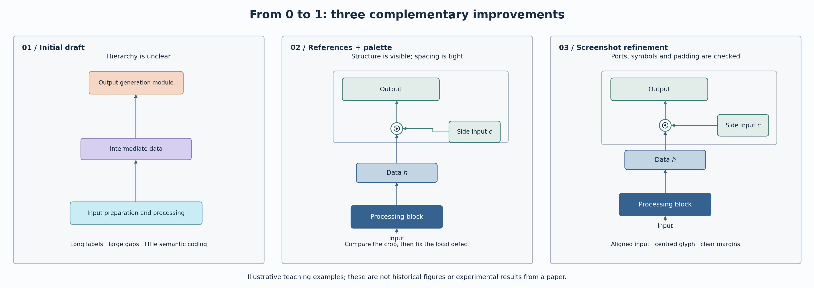

# Research Figure Studio · 科研绘图工作室

[](https://github.com/aru0988/research-figure-studio/actions/workflows/checks.yml)

**从 0 到 1 用 AI 完成可编辑科研图：找参照、定配色、看截图、修结构。**

An Agent Skill for AI-assisted scientific figures: **reference-guided design → semantic palettes → screenshot-driven refinement → editable SVG and reproducible code**.

这套 skill 把真实论文配图中反复出现的问题——配色太浅或太重、结构过于简略、箭头无处接入、运算符偏心、边界挤压——整理成可执行的绘图与检查方法。



> 上图为专门绘制的虚构教学示例，展示工作方法；不是论文原图、历史版本截图或实验结果。

## 三个核心能力

| 核心 | 具体做什么 | 解决的问题 |
| --- | --- | --- |
| **配色有依据** | 按模块角色或数据关系分配颜色，区分深色核心模块、浅色操作框与中性背景，检查对比度和灰度 | 避免“全部变浅”“全部加深”以及装饰性大色块 |
| **先找对参照图** | 优先找结构相近的原论文图，记录借鉴的分组、路径、符号和布局；只借表达方法 | 避免照着漂亮图添加模型中不存在的模块 |
| **对照截图逐处修正** | 把“这里看着不舒服”转换为可定位的端口、圆角、内边距、对齐与空间分配问题 | 避免每次推倒重画；修一个区域时同步检查整张图 |

目标是**能编辑、能解释、能迭代**。AI负责理解需求、编写绘图代码和处理反馈；这些脚本不是独立的文生图模型，也不保证一次生成就满足投稿要求。

## 安装

通过 [Skills CLI](https://github.com/vercel-labs/skills) 安装到 Codex：

```bash
npx skills add aru0988/research-figure-studio --skill research-figure-studio -a codex
```

跨项目使用时加 `-g`；Claude Code 可将 `-a codex` 换成 `-a claude-code`。请按 CLI 自身文档准备 Node.js；绘图示例另需 Python 3.10+。

也可以直接下载 [skill 文件夹](skills/research-figure-studio)，放入所用 agent 支持的技能目录。入口是 `skills/research-figure-studio/SKILL.md`，不需要上传论文或配置图像生成 API 密钥。

## 怎么用

初次绘图可以这样说：

```text
使用 research-figure-studio，根据我的方法描述和代码画论文结构图。
先核对有哪些处理步骤、数据表示、组合操作和阶段关系，再找结构相近的原论文图作为参照。
颜色体现模块角色，固定和更新状态用独立标记。
给出PNG、可编辑SVG和可复用源代码。
```

收到第一版后，提供局部截图会更有效：

```text
这张截图中，侧向输入到组合节点的连线多了一个小折弯。
把侧向输入框、运算节点及状态标记整体上移，与接入端口水平对齐。
另外，为预处理模块和状态标记留足间距，外围分组框不要贴住下方输入块。
保持已确认的计算关系，改完同时检查整图。
```

已有图但暂时不想改，也可以明确说“只记录这些问题，下次再修改”。skill会保留待办，而不会擅自覆盖图。

## 可运行的示例与组件

```bash
git clone https://github.com/aru0988/research-figure-studio.git
cd research-figure-studio
python -m pip install -r requirements.txt
python examples/generate_demo.py --output-dir docs/images
python -m unittest discover -s tests -v
```

Python组件提供稳定的语义色、对比度计算、保护分支锚点的圆角路径、同心运算符和可编辑导出。它用于支持 agent 绘图，不要求每篇论文都采用同一个模板。示例可从任意工作目录运行，并将输出写到指定目录。

电脑有多个Python时，请用同一个解释器安装依赖并运行示例；先确认该解释器可以导入Matplotlib。中文标签需指定本机可用的中文字体并检查字符覆盖；示例默认使用Matplotlib自带的DejaVu Sans。绘图不需要GPU。

## 为什么需要迭代

实际配图中，仅把颜色加深或把模块变多，往往会引入新问题。我们把这轮实践总结为：

| 观察到的缺陷 | 有效修正 |
| --- | --- |
| 图简洁，但只剩几个大框，读不出真实结构 | 恢复确有依据的处理模块、组合操作、旁路和阶段关系 |
| 深色模块配大面积蓝灰/棕色底，像控制台界面 | 用浅中性背景，让角色色集中到关键模块 |
| 下方模块区过大，上方运算和侧向输入没有接线空间 | 压缩空闲区域，将空间分给信息密集处 |
| 用字体画⊙导致内圈看起来偏心 | 以同一坐标绘制圆环与中心点 |
| 圆角化后，分支与主线脱接 | 先收集端点与交汇点，再平滑非交汇转角 |
| 为了与主干对齐，侧向通道挤压预处理和状态标记 | 让侧向路径独立分配垂直空间 |
| 分组框底边与内部模块重合 | 显式计算边界与内边距，并查看局部截图 |

完整总结见 [迭代案例](skills/research-figure-studio/references/case-study.md)。这些是实际经历的通用化总结；仓库不包含原论文的未发表模型、数据或原始截图。

## 仓库组织

```text
research-figure-studio/
├── README.md
├── LICENSE
├── requirements.txt
├── skills/research-figure-studio/
│   ├── SKILL.md
│   ├── agents/openai.yaml
│   ├── references/             # 配色、参照图、反馈迭代、实践总结
│   └── scripts/figurekit.py    # 可复用几何与配色组件
├── examples/generate_demo.py
├── docs/images/               # 原创教学图与可编辑SVG
└── tests/                     # 几何、锚点、对比度和导出检查
```

`SKILL.md`保留任务判断与关键流程，详细内容按需读取，避免把每次绘图都变成冗长清单。默认维护当前采用版；需要历史版本时明确提出。

## 适用范围与边界

适合方法结构图、实验流程图、分阶段示意图，以及需要精确数值和可编辑输出的科研图表。已有 SVG、PowerPoint、TikZ 或其他原生工具链时，优先沿用已有方式。

真实结构与数据优先于美观：不为了“高级”新增机制，不从四舍五入后的表格反算差值，不添加未经计算的显著性或误差线。字体、尺寸、文件格式等最终以目标期刊要求为准。

自动检查可发现几何和导出问题，审美与科研含义仍需要查看成图和作者判断。公开示例均为虚构教学内容；使用他人图像时，应核对来源、许可与署名要求。

## 参考与致谢

组织形式参考 [Anthropic Skills](https://github.com/anthropics/skills)、[Scientific Agent Skills](https://github.com/K-Dense-AI/scientific-agent-skills) 与 [Skills CLI](https://github.com/vercel-labs/skills)。技能格式遵循 [Agent Skills](https://agentskills.io/specification)。

科研图形原则参考 [Nature Research Figure Guide](https://research-figure-guide.nature.com/)、[Seaborn配色指南](https://seaborn.pydata.org/tutorial/color_palettes.html)、[Okabe–Ito色彩通用设计](https://jfly.uni-koeln.de/color/) 与 [Paul Tol配色说明](https://sronpersonalpages.nl/~pault/)。这些来源为方法参考，不代表其对本项目的背书。更详细的来源及适用边界见配套参考文档。

欢迎通过Issue附上可公开的局部示例、期望阅读方式与实际缺陷，帮助改进这套工作流。

## License

原创说明、代码和教学图采用 [MIT License](LICENSE)。链接的论文和第三方项目保留各自权利，不在本仓库中重新授权。
